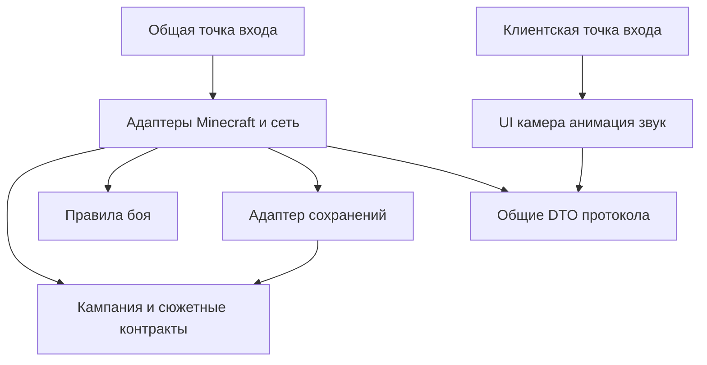
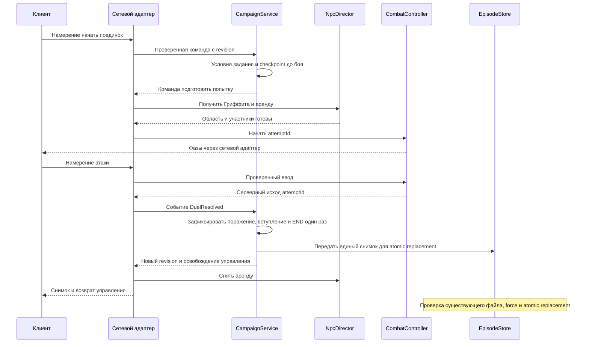

# Предлагаемая архитектура первого среза

В 1.0.0 реализован только изолированный боевой стенд: чистый Duel, серверный PrototypeArena, клиентский ввод и два payload. Подробности — [ADR 006](decisions/006-combat-prototype.md). Остальная архитектура ниже — проект полной версии; CampaignService, story_npc и сохранения ещё не реализованы. Основания: [ADR 002](decisions/002-state-and-scope.md). Один мод и один Gradle-проект, без отдельного движка сцен или универсального фреймворка.

Граница текущего эпизода задаётся конституцией: обучение только удару, защите и уклонению. Упоминания расхода выносливости, стоимости действий, захвата цели и других кандидатных систем ниже — прежние инженерные предложения, не утверждение стамины, парирования или дополнительных техник для первого эпизода. Их реализация не является условием его приёмки без отдельного решения.

## Системы и владение состоянием

| Система | Ответственность | Владелец изменяемого состояния |
|---|---|---|
| Интеграция Minecraft | Регистрация, события тика и жизни мира, сеть, сущности, чанки | Minecraft владеет миром; адаптер переводит события в команды |
| Кампания и задания | Глава, этапы заданий, флаги, проверка переходов | Серверный CampaignService, один экземпляр на загруженный мир |
| Диалоги и сцены | Узел сцены, участники, контрольные точки и эффекты | CampaignService хранит долговременный курсор; SceneRunner исполняет переходы внутри него |
| Персонажи и отношения | Постоянные сюжетные роли и события отношений | CampaignService; сущность NPC — временное представление роли |
| Бой Гатса | Время удара, дистанция, урон, выносливость, исход поединка | Серверный CombatController для активного боя; результат принимает кампания |
| Регионы и лагерь | Триггеры входа, доступность областей, привязка сцены к месту | Геометрия в контенте; открытые области в кампании; позиции в мире Minecraft |
| UI | Диалог, текущая цель, выносливость, объяснение прерывания | Клиент хранит только представление и локальный ввод |
| Ресурсы, анимация, звук | Визуальная и звуковая выразительность | Неизменяемые ресурсы; временное воспроизведение на клиенте |
| Сохранения и миграции | Кодирование, проверка версии, резервная копия, восстановление | Адаптер хранилища записывает снимок кампании, не решает сюжет |

Здоровье и инвентарь не дублируются в кампании. В первой версии выносливость — временное серверное состояние, на перезапуске попытки поединка восстанавливается до заданного стартового значения. Прогресс не привязан к UUID текущей сущности Гриффита: постоянный `bekhilitt:griffith` разрешается в загруженную сущность через адаптер.

## Зависимости и точки входа

Стрелки показывают разрешённую зависимость исходного кода, не поток сетевых сообщений.

CampaignService и правила боя не импортируют клиентские классы и не вызывают друг друга. Адаптер передаёт подтверждённый результат боя в кампанию, а эффекты кампании — исполнительным адаптерам. DTO содержат данные и версии протокола, но не ссылки на сервисы. Сохранение реализует порт, объявленный рядом с моделью кампании: ядро не зависит от реализации хранилища. Код `campaign` не импортирует `platform`; регистрация связей происходит только в общей точке входа.

Внутри campaign условия — чистые функции снимка; SceneRunner и обработчик заданий предлагают переход, а CampaignService проверяет и применяет его единожды. Не вводить взаимные подписки, где задание меняет сцену, а сцена независимо меняет то же задание. Конкретные точки входа и будущие файлы перечислены только в [карте](PROJECT_MAP.md).

## Серверная ответственность

Даже одиночная игра использует встроенный сервер. Он принимает команды взаимодействия с NPC, выбора ответа и атаки. Проверяет участника кампании, текущую сцену, revision состояния, допустимость действия, дальность и время. Повторный requestId не применяет эффект повторно. Сервер рассчитывает удары, выносливость, условия заданий и исходы; клиент не присылает «задание выполнено» или величину награды.

Изменения выполняются последовательно в серверном потоке. Асинхронная загрузка может подготовить неизменяемые определения; заменить действующий контент можно только целиком после проверки и вне активной сцены. В первом прототипе горячая перезагрузка сюжетных данных не нужна.

## Клиентская ответственность

Клиент получает снимок с revision при входе и повторном подключении, затем упорядоченные обновления. Пропуск версии вызывает запрос нового снимка; старый пакет не откатывает состояние. Выбор ответа включает sceneRunId и ожидаемую revision. Локальные камера и анимация могут закончиться раньше или позже сети, но не продвигают сюжет самостоятельно.

При отмене, смерти, потере соединения и смене мира клиент освобождает камеру и ввод, останавливает временный звук и закрывает диалог. Открытие меню паузы не считается завершением сцены; не использовать реальное время для обязательного сюжетного перехода. На выделенном сервере не должны загружаться UI, рендерер и звуковой код.

## Состояние и производительность

Долговременный снимок: campaignId, participant UUID, schemaVersion, contentVersion, revision, глава, задания, флаги отношений, открытые регионы, курсор сцены и журнал эффектов. Сериализация и восстановление подробно заданы в [контракте данных](STORY_DATA.md).

Триггеры проверяются для активной области и участника, а не по всему миру каждый тик. NPC вне активной сцены не требуют покадрового сценарного исполнения. Модели, музыка и декоративные сущности не могут определять сюжетную готовность. Атмосфера строится на палитре, силуэтах, свете обычной игры, композиции и звуке; шейдеры не обязательны. Бюджеты производительности устанавливаются после выбора оборудования; метод измерения — в [плане](PROTOTYPE_PLAN.md).

## Загрузка и регистрация на Fabric

Кандидат версий и пределы проверки зафиксированы в [ADR 001](decisions/001-stack.md). Следующие названия API подтверждены официальными материалами для 1.21.11; их использование в Bekhilitt ещё предстоит скомпилировать.

1. Fabric Loader читает `fabric.mod.json`: общий entrypoint `main` и отдельный `client`. `BekhilittMod` реализует `ModInitializer.onInitialize`, клиентская точка — `ClientModInitializer.onInitializeClient`. Это подтверждают [общий пример](https://github.com/FabricMC/fabric-example-mod/blob/e92cc90e7fc8e130c042ea1cdc7c7bb748194d81/src/main/java/com/example/ExampleMod.java), [клиентский пример](https://github.com/FabricMC/fabric-example-mod/blob/e92cc90e7fc8e130c042ea1cdc7c7bb748194d81/src/client/java/com/example/client/ExampleModClient.java) и [метаданные](https://github.com/FabricMC/fabric-example-mod/blob/e92cc90e7fc8e130c042ea1cdc7c7bb748194d81/src/main/resources/fabric.mod.json). Общая инициализация не читает ещё не загруженный мир.
2. Общая регистрация: сначала используемые типы компонентов предмета, затем предметы, тип NPC и атрибуты; после этого типы сетевых payload и обработчики жизненного цикла. Предлагается один тип `bekhilitt:story_npc` с characterId и один учебный меч `bekhilitt:training_sword`. Нет отдельного EntityType на каждую реплику или главу.
3. Предмет регистрируется через `Registry.register` в `BuiltInRegistries.ITEM`, с `ResourceKey` и `Item.Properties.setId`, как в [руководстве предметов](https://docs.fabricmc.net/1.21.11/develop/items/first-item). Тип сущности — `EntityType.Builder` и `BuiltInRegistries.ENTITY_TYPE`; атрибуты — `FabricDefaultAttributeRegistry`, согласно [руководству сущностей](https://docs.fabricmc.net/1.21.11/develop/entities/first-entity). AI первого NPC использует goals, а не новую библиотеку деревьев поведения.
4. Если мечу нужна привязка профиля, зарегистрировать `DataComponentType` с codec в `BuiltInRegistries.DATA_COMPONENT_TYPE`; [руководство компонентов](https://docs.fabricmc.net/1.21.11/develop/items/custom-data-components) подтверждает persistent codec. При одном фиксированном профиле компонент не нужен: не добавлять его ради демонстрации. Сюжетное состояние не хранить в item component. Идентичность NPC хранится в данных сущности и сверяется с записью кампании, не в компоненте меча.
5. На загрузке серверных ресурсов собственный StoryContentLoader разбирает и проверяет определения. На готовности мира PersistenceAdapter загружает снимок, проводит допустимые миграции и создаёт сервис на этот мир. Названия и сигнатуры callback загрузки/остановки сервера, регистрации reload listener и событий сущности **ещё не сверены**; это обязательная точечная проверка P0/P1 по исходникам выбранной Fabric API, не придуманные методы.
6. На входе игрока проверить протокол и участника; прислать разрешённый снимок, затем разрешить взаимодействия. Во время тиков исполняются только активные сцены, бой и локальные триггеры. При сохранении адаптер использует `SavedData`, `SavedDataType`, `Codec` и `setDirty`, подтверждённые [руководством Saved Data](https://docs.fabricmc.net/1.21.11/develop/saved-data). Конкретное имя файла и codec будут закреплены в реализации P1.
7. На выгрузке мира освободить аренды NPC/камеры и временные ссылки, сохранить штатным путём, убрать экземпляр сервиса. Статические поля допустимы для неизменяемых регистраций, но не для кампании: второй открытый мир не должен наследовать её состояние.
8. Клиент регистрирует свои обработчики, рендереры и интерфейс. Ресурсы из `assets/bekhilitt` поставляются внутри JAR как встроенный ресурспак; JSON из `data/bekhilitt/story` читает собственный серверный загрузчик. Точные API регистрации рендерера и версия метаданных отдельного экспортируемого ресурспака ещё не проверены; отдельный пак в P0 не требуется. Анимационная библиотека не является зависимостью первого среза.

## Публичные границы пакетов

Это логические границы одного проекта. Малые пакеты появляются только вместе с работающей функцией. Термин «порт» здесь означает небольшой Java-интерфейс, нужный для отделения хранилища; глобальная шина событий не предлагается.

| Пакет относительно `dev.bekhilitt` | Публичная граница | Что не входит в ответственность |
|---|---|---|
| `campaign` | CampaignService: принять типизированную команду, вернуть результат/снимок; модели и порт сохранения | Рендер, поиск сущностей, прямые сетевые вызовы |
| `campaign.quests` | Проверить цель и предложить переход этапа | Самостоятельно записывать кампанию или выдавать предметы |
| `campaign.dialogue` | Разрешённые ответы и проверка выбранного узла | Экран диалога, актёрская озвучка |
| `campaign.cinematics` | SceneRunner: шаг, checkpoint, skip/recovery; список постановочных команд | Движение камеры в клиенте, обход условий заданий |
| `campaign.characters` | Постоянные записи персонажей, условия отношений | Навигация сущностей и самостоятельное изменение главы |
| `combat` | CombatController: принять намерение при проверенном контексте, выдать фазу и исход | Сюжетные награды и клиентские кости модели |
| `platform` | Сборка сервисов, адаптация событий, регистрация игровых объектов | Авторство сюжетных решений |
| `platform.characters` | StoryNpcEntity и NpcDirector: разрешить characterId, арендовать управление, освободить | Собственная копия прогресса отношений |
| `platform.world` | RegionTracker: вошёл/вышел; подготовить локальную сцену | Глобальный обход чанков, хранение открытых заданий |
| `platform.persistence` | Реализация порта сохранения и миграций | Выбирать следующий этап истории |
| `platform.networking` | Проверить пакет, вызвать команду через адаптер, отправить DTO | Доверять заявленному клиентом результату боя |
| `protocol` | Версии, ограниченные DTO и codecs; общие для физических сторон | Живые сервисы, клиентские классы и скрытый сюжетный снимок |
| `client.ui` | Диалог, цель, выносливость | Утверждать переход задания |
| `client.rendering` | Позы, модели и анимация; использование CameraController | Рассчитывать действительное попадание |
| `client.audio` | Проигрывание и остановка звука по cue | Продвигать сцену по окончанию аудио |

Правило внутри campaign: сервис зависит от обработчиков quests/dialogue/cinematics/characters; обработчики используют неизменяемые модели и возвращают предложение перехода, не вызывают сервис обратно. Публичные изменяющие методы обработчиков не экспортируются в platform. Общие типы размещаются рядом с campaign либо в protocol по назначению, без папки «utils» для всей логики. Клиент импортирует protocol, но не серверные реализации.

## Четыре области состояния

| Область | Постоянное состояние и владелец | Временное состояние и владелец |
|---|---|---|
| Мир | Minecraft: блоки/сущности; CampaignService: глава, задания, открытые регионы | RegionTracker: присутствие участника в активной области |
| Игрок | Minecraft: инвентарь/здоровье; CampaignService: participantId и сюжетные факты игрока | CombatController: выносливость/фаза; клиент: только UI и ввод |
| Персонаж | CampaignService: characterId, placementEpoch, глава размещения, отношения; Minecraft сохраняет физическую сущность | NpcDirector: ссылка на загруженную сущность и владелец её управления |
| Сцена | CampaignService: runId, checkpoint, attemptId и appliedEffects | SceneRunner: ожидание события; клиент: камера/звук с токеном текущей сцены |

Ссылка на сущность — кэш, не доказательство существования или смерти персонажа. Изменение главы меняет желаемое размещение и placementEpoch в кампании; при загрузке сущности с прежним epoch она не включается в новую сцену. Проекция NPC не может записать старую главу поверх новой.

## Жизнь сюжетных NPC

NpcDirector поддерживает индекс только загруженных сюжетных NPC: characterId → entity UUID, dimension, placementEpoch. Запись NPC в кампании содержит желаемый регион и epoch. При загрузке чанка NPC предъявляет эти данные; при выгрузке удаляется ссылка из индекса. Запись кампании остаётся. Не искать Гриффита обходом всех сущностей мира каждый тик.

Если нужный NPC отсутствует, подготовка сцены сначала проверяет его ожидаемый локальный чанк и состояние размещения. Отсутствие в индексе не означает разрешения немедленно создать копию. Новую проекцию создавать только после завершения загрузки ожидаемой области или после явного изменения placementEpoch. Старые проекции при последующей загрузке сверяются и удаляются/отключаются адаптером. При дубликате одного epoch сцену приостановить, оставить одну подтверждённую проекцию и записать диагностику. Этот алгоритм требует интеграционной проверки, особенно после аварийного выхода.

Режимы: `FREE` (ограниченная прогулка/взгляд), `SCENE` (постановка), `DUEL` (боевой контроллер), `SUSPENDED` (нет участника или области). Аренда управления имеет sceneRunId и attemptId; только её владелец выдаёт команды. В SCENE обычные цели движения временно уступают постановке; в DUEL движением управляет бой. Завершение, смерть, отмена, выгрузка и тайм-аут всегда освобождают аренду. На загрузке аренда не восстанавливается вслепую: сначала восстановить контрольную точку, участников и область.

Первый срез использует компактную фиксированную тестовую область и перенос участника после готовности. После выявленной unload/resume-регрессии используется временный непостоянный chunk ticket, ограниченный областью сцены и сроком попытки; он снимается в любом пути завершения (ADR 007). Постоянная загрузка лагеря и всех сюжетных регионов не нужна. Гриффит и остальные персонажи различаются данными, поведением и постановкой, а не отдельными копиями системы кампании.

## Боевая модель Гатса

Предлагаемый автомат действия: `IDLE → WINDUP → ACTIVE → RECOVERY → IDLE`; `STAGGERED`, смерть и отмена попытки прерывают разрешённые фазы. В начале допустимой атаки сервер списывает выносливость один раз и назначает attackId. В ACTIVE сервер проверяет дистанцию, направление, препятствия и допустимую цель; одна цель получает не более одного попадания на attackId. Длительности и стоимость — данные профиля, не числа из длины клиентской анимации.

Networking проверяет личность отправителя, частоту сообщений и текущую попытку; CombatController дополнительно проверяет оружие, фазу, жив ли игрок, доступную выносливость и границы арены. Контекст позиции берётся с сервера. Клиент присылает намерение атаки, а не список поражённых целей. Клиентская анимация отображает серверную фазу и может интерполировать её; потеря кадра или звука не меняет урон.

В первом эпизоде противник — Гриффит: игрок учится только удару, защите и уклонению, затем Гриффит завершает поединок постановочным приёмом. Каноническое поражение ведёт к вступлению и концу эпизода. Долгий бой с бесконечным здоровьем не допускается; конкретная постановка приёма ещё не выбрана. Границы — в [плане](PROTOTYPE_PLAN.md). Проверить ощущение веса, читаемость подготовки удара, задержку ввода и соответствие видимого оружия зоне попадания. Отдельно проверить, что ванильная атака не наносит дополнительный урон параллельно кастомной: точка перехвата ещё не выбрана, её надо подтвердить по API/исходникам 1.21.11. Mixin допускается только после доказанного отсутствия подходящего события и с узким тестом. Сетевую компенсацию задержки и полноценную боевую систему первого среза не обещать.

## Протокол первого среза

[Официальное руководство 1.21.11](https://docs.fabricmc.net/1.21.11/develop/networking) подтверждает `CustomPacketPayload`, `StreamCodec`, регистрацию `PayloadTypeRegistry.playC2S/playS2C` и обработчики `ServerPlayNetworking`/`ClientPlayNetworking`. Имена сообщений ниже — проект Bekhilitt, не API Fabric.

| Категория | Направление | Содержимое и ограничения |
|---|---|---|
| Версия и готовность | Обе стороны | Версия протокола/контента; несовместимость запрещает запуск сцены |
| Намерение взаимодействия | C2S | requestId, actorId, expectedRevision; сервер проверяет близость и доступность |
| Ответ, пропуск, отмена | C2S | runId, attemptId, nodeId, choiceId; только текущий разрешённый вариант |
| Атака | C2S | Последовательность ввода и attemptId; ограничение частоты, без урона от клиента |
| Снимок/изменение | S2C | revision, видимые задания/диалог/разрешённые ответы; без будущих сцен и скрытых отношений |
| Постановка/бой | S2C | actorId, token, серверная фаза, cueId, время; только участнику и нужным наблюдателям |
| Отказ/повторная синхронизация | Обе стороны | Причина отказа или запрос снимка; ограниченный размер и частота |

Все коллекции, строки и числа ограничены codec/валидатором. Повторный пакет не повторяет действие; устаревший runId отклоняется. Очередь запросов ограничена. При входе после загрузки мир восстанавливается прежде снимка клиента. Одновременный второй участник кампании в прототипе не поддержан; ему явно запрещается запуск сюжета. Проверка выделенного сервера проверяет границу сторон, а не готовность кооператива.

> Для реализованного первого эпизода действует ADR 007: каноническое поражение и вступление заканчивают эпизод в END. camp_intro относится только к будущему расширению.

## Поток первого поединка

Ниже — архитектурная схема согласованного первого поединка, не журнал игрового QA. Флаг завершения и граница END определены в [реестре сцен](story/SCENES.md); конкретный файловый адаптер — ADR 007.

Если NPC не найден или игрок умер, адаптер передаёт прерывание, а кампания возвращается к recoveryNode без `DuelResolved`. После аварии загружается последний сохранённый checkpoint. Повтор уже принятого исхода не меняет appliedEffects. Сохранение исхода, вступления и ledger — одна модель перехода; отдельный NPC не выдаёт следующую миссию.

## Частоты и измерения

Предварительная инженерная гипотеза: активный бой и постановочные перемещения проверяются каждый серверный тик; небоевая переоценка целей локального NPC — раз в 10 тиков; границы регионов — при смене позиции/чанка либо раз в 5 тиков. Это значения для измерения, не утверждённые бюджеты. Вне загруженной активной области нет собственного цикла симуляции NPC. Точный график ванильных goals нельзя обещать без проверки реализации.

Кэшировать ссылки на загруженных NPC и определения ресурсов; инвалидировать при выгрузке/смене контента. Ограничивать число одновременных поисков пути, не пересчитывать маршрут при неизменной цели каждый тик. Клиент держит ресурсы активного набора; не загружает всю будущую озвучку. Измерять время тика, p95 времени кадра, память, число загруженных чанков/NPC и объём пакетов в одинаковом тестовом мире без шейдеров. Сравнивать покой, бой и повтор сцен; рост памяти после повторов требует расследования. Числовая приёмка зависит от оборудования из конституции.

## Проверка границ и диагностика

В P1 нужны чистые тесты условий, переходов, идемпотентности и миграций; в P2–P4 — интеграционные проверки мира, NPC, сети и управления. Отдельный запуск сервера выявляет случайные клиентские импорты. Проверять не только штатное прохождение, но и повтор пакета, старую revision, выгрузку чанка, смерть, разрыв соединения и остановку на контрольной точке.

Предлагаемые, **ещё не реализованные**, команды только для разработки: `/bekhilitt debug state`, `/bekhilitt debug scene <id>`, `/bekhilitt debug interrupt`, `/bekhilitt debug reset-test`. Первая показывает revision/checkpoint и активные аренды; вторая запускает сцену в специально созданном тестовом мире; третья воспроизводит прерывание. Reset допускается только для помеченной тестовой кампании и не стирает обычный мир. Нужны права оператора и явный dev-режим; команда не должна обходить валидатор контента.

Журнал переходов содержит campaignId, sceneId, runId, attemptId, старый/новый revision, событие и причину отказа. Секреты и полный текст переводов в лог не нужны. Для воспроизведения сохранять версию мода/контента, seed тестового мира, checkpoint, последовательность ввода и тип прерывания. Полный набор критериев — в [плане](PROTOTYPE_PLAN.md).

## Управление с ориентиром на Dark Souls

Направление утверждено; первый эпизод обучает только удару, защите и уклонению. Остальные механики этого раздела — кандидаты, не требования текущего эпизода; клавиши, стамина и парирование не утверждены. Настройки баланса ещё не выбраны. Участие в кампании не требует переноса прочих систем Dark Souls.

### Ввод и контроллер игрока

Предлагается `client.input.InputRouter`: физические клавиши/кнопки мыши → именованные действия `move`, `look`, `light_attack`, `heavy_attack`, `dodge`, `guard`, `sprint`, `lock_target`, `switch_target`, `interact`. Игровая логика не читает код клавиши. Однократные нажатия отделены от удержания. Привязки сохраняются в клиентских настройках, подсказки показывают актуальные клавиши; обнаруживаются конфликты с ванильными действиями. Чат, меню и ввод текста не запускают бой. Потеря фокуса, смерть и начало сцены очищают удержания и буфер.

`client.control.PlayerController` выбирает локальный режим FREE/LOCKED/SCENE, преобразует направление относительно камеры в намерение движения и отправляет команды. Он не назначает урон, стоимость выносливости или сюжетный результат. `platform.control` связывает серверные ограничения combat с ванильным перемещением игрока. Ванильные коллизии и сетевые проверки движения сохраняются; не вводить второй независимый канал телепортации. В P0C требуется проверить, как ограничивать движение/поворот в фазах удара без конфликта с обычными пакетами позиции и коррекциями сервера.

Небольшой буфер хранит максимум одно ожидающее дискретное действие с sequence и сроком годности. Предлагается серверное принятие в ограниченную очередь с отсчётом от получения, без доверия клиентскому времени. При открытии разрешённого окна действие потребляется один раз. Буфер сбрасывается при смене попытки/мира; повтор пакета не продлевает срок. Длительность подбирается по результатам теста, не переносится из чужой игры. Клиент может сразу показать подготовительный отклик, но подтверждённая боевая фаза приходит от сервера.

### Камера и цель

`client.camera.CameraController` — единственный владелец итоговой игровой камеры: свободная орбита от третьего лица, захват цели или аренда кат-сцены. Обновлять после движения, интерполировать с учётом времени кадра. Ограничить pitch и проверять препятствия между точкой наблюдения на игроке и желаемой камерой; подтягивать камеру перед стеной с запасом для ближней плоскости, плавно возвращать расстояние. Проверять углы, потолки, лестницы и узкие проходы, а не только один луч в открытом поле. После возрождения сбрасывать накопленное сглаживание.

TargetSelector выбирает из загруженных допустимых противников по положению на экране, дистанции и видимости. Переключение выбирает соседнюю цель в запрошенном направлении; небольшая устойчивость выбора предотвращает прыжки между целями. Смерть, выгрузка, смена мира и превышение допустимой дистанции снимают захват. Краткое перекрытие видимости может сохранять захват только по проверяемой политике; оно не разрешает удар сквозь стену. Клиентский targetId — подсказка интерфейса/намерение, сервер заново проверяет цель при действии.

### Действия и анимация

Расширение CombatController: лёгкая/сильная атака, уклонение, защита и спринт как разные действия с общей таблицей переходов. IDLE разрешает запрос действия при выполнении условий. WINDUP/ACTIVE/RECOVERY содержат явные разрешённые переходы; уклонение не отменяет любое действие автоматически. STAGGERED и смерть отменяют очередь по правилам профиля. Защита проверяет серверные направление и состояние; наличие неуязвимости при уклонении — отдельная гипотеза, не готовая механика.

Профиль действия задаёт движение и предел поворота для каждой фазы, правила расхода/восстановления выносливости и возможность прерывания. Сервер ограничивает действие и подтверждает попадание; визуальное смещение модели не двигает серверную сущность. Для первого стенда не использовать root motion как источник положения. Клиентская анимация получает actionId, фазу и серверный tick; пропуск кадров не удлиняет окно урона. При отклонении предсказания клиент согласует позу с сервером без повторной атаки.

### Границы новых пакетов

| Будущий пакет | Отвечает за | Не отвечает за |
|---|---|---|
| `client.input` | Привязки, контекст ввода, нажатия/удержания | Правила попадания и стоимость действия |
| `client.control` | Локальный режим управления, намерение движения и выбор цели | Авторитетную позицию, кампанию |
| `client.camera` | Орбита, коллизия камеры, кадрирование и аренда сцены | Передвижение игрока и выдачу наград |
| `platform.control` | Интеграцию ограничений combat с движением Minecraft | Рендер, привязки клавиш |

Разрешённые зависимости: input → локальные контракты control; control → protocol; camera → неизменяемое представление control; rendering → представление camera. Кат-сцены передают камере запрос аренды через клиентский координатор, а не меняют её параллельно. На сервере platform.control → combat; combat не импортирует client или platform. Эти пакеты относятся к тому же единственному модулю сборки. Cinematics не владеет физическим вводом, а задаёт допустимые намерения через серверную политику.

### Выполнимость и неподтверждённые вмешательства

В [документации Fabric 1.21.11](https://docs.fabricmc.net/1.21.11/develop/key-mappings) и [официальном примере](https://github.com/FabricMC/fabric-docs/blob/main/reference/1.21.11/src/client/java/com/example/docs/keymapping/ExampleModKeyMappingsClient.java) подтверждены `KeyMapping`, `KeyBindingHelper.registerKeyBinding`, клавиатура/мышь через InputConstants и обработка `consumeClick` в `ClientTickEvents`. Это основание для переназначаемого ввода, не доказательство готового контроллера Dark Souls.

[Исходные mappings камеры 1.21.11 от Fabric](https://github.com/FabricMC/yarn/blob/1.21.11/mappings/net/minecraft/client/render/Camera.mapping) показывают обновление камеры, вращение и проверку расстояния до препятствий. Они используют **Yarn**, тогда как проект выбрал Mojang mappings: имена нельзя копировать напрямую или считать публичным Fabric API. Возможность существования точки вмешательства подтверждена структурой, конкретный hook/Mixin, его видимость и совместимость **не проверены**. То же относится к развязке направления камеры и тела, подавлению ванильной атаки, движению при уклонении и ограничениям поворота. Всё это — риск P0C, требующий компиляции и игрового теста на выбранном стеке.

Для геймпада нет проверенного решения: библиотека не выбрана и зависимость не добавлена. Отдельная оценка должна проверить поддержку 1.21.11/Fabric, лицензирование, совместимость привязок, стики/мёртвые зоны, подсказки и отключение устройства. До неё прототип оценивается только с клавиатурой и мышью.

## Защита сюжетной последовательности

CampaignService проверяет не только текущий этап задания, но и prerequisite-события, состояние персонажей и разрешённое раскрытие главы по [реестру хронологии](story/CHRONOLOGY.md). Карточки и правила валидации — в [STORY_DATA](STORY_DATA.md). Порядок нельзя выводить только из номера серии: воспоминание меняет доступные знания зрителя, но не переносит живого персонажа в прошлое.

Сохранение содержит completedEventIds и revealedFactIds в той же ревизии, что исход сцены; сетевой снимок отдаёт только разрешённые сведения. Предметы/способности выбираются по разрешённому профилю текущего этапа. Тестовые профили управления и альтернативные исходы имеют testOnly и не записываются в обычную кампанию. Для поединка вступления только канонический исход завершает joining_duel_resolved; неожиданный результат не считается новым каноном и возвращает к контролируемой точке восстановления. Постановка этого исхода должна сохранять понятную причину поражения, без скрытого бесконечного здоровья NPC.

## Характеристики и развитие персонажей

Утверждённое направление — собственные характеристики и каноническое развитие Гатса. Числа, формулы и система уровней пока не выбраны. Предлагается неизменяемый CharacterProfile: здоровье, сила, выносливость и только нужные дополнительные параметры; допустимые способности и формы привязаны к персонажу, событию и свидетельству. Поле универсальной маны отсутствует. Специальный ресурс создаётся лишь для подтверждённой способности; у Гатса не появляется школа заклинаний ради унификации.

Профиль задаёт базу, ProgressionRecord — приобретённые физические/боевые улучшения, снаряжение — допустимые модификаторы, временные эффекты — ограниченные модификации. StatsResolver получает эти входы и вычисляет производные параметры удара, защиты и максимальных ресурсов; он не хранит второй инвентарь или здоровье. Порядок расчёта фиксируется: база → разрешённое развитие → экипировка → временные эффекты → ограничения этапа. Формулы и единицы должны быть версионируемыми данными, без произвольного кода в JSON. Нельзя незаметно удваивать ванильную броню и собственную защиту.

Текущее здоровье остаётся у серверной LivingEntity Minecraft; профиль задаёт желаемый максимум через один адаптер атрибутов. Выносливость и фаза действия принадлежат CombatController. Клиент получает только разрешённый результат расчёта. Серверный путь урона: проверенный attackId → попадание и окно фазы → исходная сила действия → один расчёт защиты/сопротивления → применение урона один раз → проверка прерывания/исхода. Точная точка подключения к ванильной обработке урона и атрибутам ещё требует проверки выбранных исходников 1.21.11; описание не является готовым API.

Временный эффект содержит effectTypeId, sourceId, stackKey, правило объединения, оставшиеся серверные тики, приоритет и политику снятия. Случайные независимые множители запрещены: валидатор отклоняет конфликтующие режимы стека и недопустимые числа. Эффекты попытки снимаются при её завершении; постоянная сюжетная травма — отдельный факт кампании, а не бесконечный боевой таймер. Изменение максимума здоровья не лечит автоматически; явная политика ограничивает текущее значение новым максимумом. Анимация показывает эффекты и фазы, но не добавляет урон самостоятельно.

### Развитие с пределами главы

Предложение: небольшой набор улучшений физической подготовки и владения оружием внутри главы, с пределами текущего этапа; новый диапазон и снаряжение открываются только подтверждённым сюжетным событием. Никакого бесконечного накопления силы от повторного убийства слабого врага. Количество очков, наличие уровней и способы заработка пока не утверждены. До их выбора тестировать типизированные факты практики/вех, а не обещать конкретную экономику опыта.

CampaignService единолично применяет запрос развития: проверяет prerequisite, лимит главы, источник достижения и постоянный grantId; затем сохраняет ProgressionRecord и appliedEffects в одном снимке. Повтор сцены, босса или загрузки не выдаёт развитие повторно. Развитие, оборудование и abilities текущего этапа не могут отменить обязательный сюжетный исход. При открытии новой главы пределы меняются явно; временное ограничение не стирает историю достижений. Смена правил требует миграции, не молчаливого обнуления.

| Будущий пакет | Публичная граница | Не владеет |
|---|---|---|
| `combat.stats` | Чистый StatsResolver и определения модификаторов | Здоровьем сущности, инвентарём, сохранением |
| `combat.effects` | Жизненный цикл временных эффектов активного боя | Главой и постоянными достижениями |
| `campaign.progression` | Проверка доступного развития и предложение перехода | Самостоятельной записью состояния или сетевыми наградами |
| `combat.bosses` | BossEncounterController: фаза, попытка и боевой результат | Каноническим прогрессом, клиентской анимацией |

CampaignService вызывает progression, результат расчёта профиля передаёт platform в combat. CombatController использует stats/effects, BossEncounterController использует общие правила combat и возвращает результат адаптеру. Ни один из них не вызывает CampaignService обратно; platform маршрутизирует итог как проверенное событие. Все пакеты — внутри одного проекта; создавать по этапу реализации.

## Боссы и канонические исходы

Кандидаты, источники и конфликты охвата хранятся только в [реестре боссов](story/BOSSES.md). BossEncounterDefinition задаёт персонажа, аренную область, prerequisite, цель встречи, формы/фазы, атаки, уязвимости, условия переходов и outcomePolicy. Уязвимость игрового дизайна маркируется как предложение, если источник подтверждает лишь видимый приём. Универсальное сопротивление магии и атаки из поздней арки не добавляются по умолчанию.

Фаза имеет enter/exit-эффекты, разрешённые действия, серверные условия перехода и максимальное ожидание. При одновременных условиях применяется явный приоритет, один переход за шаг; смена формы не сбрасывает историю попаданий старого attackId. Сообщение клиенту содержит phaseId, formId, actionId, tick и attemptId; при повторном подключении приходит снимок, а не требование досмотреть потерянную анимацию. Переход не ждёт бесконечно подтверждения проигрывания.

Цель встречи объявляется игроку заранее: например, пережить столкновение, а не «убить» с последующей отменой победы кат-сценой. Результаты различаются: PLAYER_FAILED, INTERRUPTED, OBJECTIVE_MET и STORY_TRANSITION. Смерть босса допустима только при соответствующей outcomePolicy; полоса здоровья при неубийственной цели не должна обещать смертельный исход. Конкретная постановка проверяется игровым отзывом.

Арена загружается локально вокруг участника, не весь сюжетный мир. Выход за границу, отсутствие критического чанка/NPC или потеря участника прерывают попытку без награды; обход границы не засчитывает успех. При необходимости ticket ограничен ареной/попыткой и освобождается во всех путях. Уничтожение блоков не должно позволять обойти обязательный триггер; политику границ явно задаёт тестовая арена.

Сохраняется контрольная точка до встречи и подтверждённый результат, а не произвольный кадр босса. После смерти/выхода до исхода создаётся новая attemptId, сбрасываются здоровье босса и временные эффекты; участник восстанавливается по явно заданной политике тестовой попытки. Инвентарь не клонируется из checkpoint, расходуемые предметы в первом тесте не используются. После принятого результата CampaignService атомарно в модели обновляет событие, развитие и appliedEffects; физическая запись имеет ограничения Saved Data из STORY_DATA. Повтор результата со старой попыткой отвергается. Сохранение во время формы босса не должно при загрузке создавать вторую сущность или бесплатно завершать встречу.

## Сюжетный интеллект и профиль Гриффита

Гриффит — второй главный персонаж повествования; управляемый герой остаётся Гатсом. Сюжетный интеллект предлагается как детерминированная связка авторского этапа, памяти, текущей цели и ситуативного AI. LLM не требуется и не управляет каноном, репликами или переходами. Общий механизм обслуживает сюжетных персонажей, а богатый профиль Гриффита содержит конкретные авторские правила из [GRIFFITH](story/GRIFFITH.md); универсальный симулятор личности не нужен.

| Уровень | Данные и владелец | Исполнение и ограничения |
|---|---|---|
| Личная история | CharacterRecord.personalStageId и capabilityProfileId, CampaignService | Только подтверждённый переход по событию, отдельный от текущего местоположения |
| Знания и память | knownFactIds и memoryRecords с eventId/provenance, CampaignService | Наблюдение, доклад или явное авторское предоставление знания; завершение квеста само не сообщает факт всем |
| Отношения | Направленный relationContext к Гатсу с основаниями, CampaignService | Сюжетные изменения и ограниченные оттенки; не шкала подарков |
| Цель/занятие | persistent goalId/activityCheckpoint в CharacterRecord | CharacterDirector предлагает допустимую цель, сервис подтверждает; локальное выполнение у NpcDirector |
| Тактика | Текущая цель движения/атаки, NpcDirector и CombatController | Только разрешённые capabilities, без изменения личной истории |
| Выразительность | PresentationProfile и cueId; клиент воспроизводит | Взгляд, поза, пауза и звук не создают знание или сюжетный эффект |

Предлагаемый CharacterDirector размещается в существующем `campaign.characters`: читает неизменяемый снимок и выдаёт план занятия/варианты реакции. Он не пишет мир и не вызывает CampaignService обратно. Обновления памяти и отношений применяет только сервис. `platform.characters` исполняет намерение на загруженной проекции; `campaign.dialogue` выбирает доступный узел, `client.rendering` воспроизводит cue. Новые модули сборки не создаются.

Приоритеты: запрет по каноническому/физическому состоянию и обработка смерти/выгрузки → действующая аренда сцены → разрешённый бой → текущее авторское занятие → свободная локальная реакция. Сцена не может приказать действие, запрещённое capabilityProfile. Каждый запрос управления содержит token и revision; завершённая аренда не принимает поздние команды. При прерывании исполнитель освобождает путь, цель, камеру и временные эффекты; Director заново выбирает допустимое занятие с восстановленной контрольной точки.

Событие проходит единый путь: platform подтверждает результат → CampaignService проверяет eventId и знание участника → в одном снимке обновляет память, личный этап/отношения и appliedEffects → Director выбирает актуальную цель → адаптер назначает занятие → клиент показывает доступную реакцию. Повтор eventId не усиливает отношения и не повторяет награду. Пересчёт после загрузки восстанавливает тот же логический выбор; если допустимы несколько декоративных вариантов, выбор фиксируется на эпизод занятия, а не случайно меняется каждый тик.

DialogueSelector проверяет personalStageId, knownFactIds, relationContext, capabilities, собеседника и контекст сцены. При несовпадении используется нейтральный допустимый fallback, без будущих сведений. Взаимоисключающие состояния и реплики проверяются валидатором. Клиент не получает полный внутренний профиль, скрытые мысли или будущие узлы; получает только текущие доступные действия и отображаемые реакции.

Успехи и падения изменяют не только числа: командные полномочия, социальный доступ, речевые и двигательные возможности, выбор занятий. StatsResolver использует только обоснованные физические параметры из capabilityProfile; relationContext и абстрактная мечта не входят в формулу силы. При недоступности персонажа миру не выдаётся невидимый командир, раздающий приказы из выгруженной сущности.

CharacterRecord привязан к стабильному characterId, не UUID проекции. Загрузка чанка восстанавливает представление текущего этапа/цели, а не старый сохранённый AI. Память и личная линия продолжают существовать без активной сущности; это не лицензия автономно завершать будущие события. Значимые занятия продвигаются только разрешённым событием, косметическая активность вдали не симулируется. Миграции отдельно проверяют personalStageId, факты и relationContext; неизвестные ID не стираются молча.

## Подготовка будущего управления Гриффитом

Требование расширяемости утверждено; игровая кампания сейчас проектируется за Гатса. Формат будущего режима не выбран. Основание выбора — [ADR 004](decisions/004-playable-character-boundary.md).

### Личность профиль и управление

`characterId` обозначает Гатса или Гриффита независимо от пользователя и физической сущности. CharacterRecord содержит личную историю, знания, отношения и развитие; CharacterProfile ссылается на характеристики, набор действий, допустимую экипировку, анимации и cameraProfile. Гатс и Гриффит используют разные профили боевого стиля, но конкретные действия каждого ещё сверяются с сериалом. Камерный профиль задаёт предложение кадрирования, а пользовательские чувствительность и переназначения остаются личными настройками.

ControlBinding — отдельная серверная запись: characterId, source (`AI`, `PLAYER`, `SCENE`, `NONE`), controllerUserId при PLAYER, projectionId, generation и разрешённый контекст. Один персонаж имеет не более одного действующего источника команд и одной активной проекции; один пользователь управляет не более чем одним героем. Это ограничение первого проекта, не готовый кооператив.

ActionIntent содержит actorCharacterId, actionId, параметры, sequence и bindingGeneration. PlayerInputAdapter и AIIntentAdapter формируют одинаковые семантические намерения. Серверный ActionGate проверяет действующую привязку, право источника, возможности героя, главу, сцену, фазу, ресурс и цель; затем передаёт действие CombatController или адаптеру взаимодействия. AI не обходит стоимость и восстановление атаки. У сети дополнительно есть проверка отправителя/частоты; внутренний AI не подделывает сетевой пакет. Адаптеры физического движения могут различаться для Player и Mob, но используют общие ограничения действия. Сюжетное событие не маскируется под боевую команду.

Предлагаемое расположение: ActionGate/ActionIntent рядом с существующим `combat`, ControlBinding и контроль передачи — `platform.control`, AIIntentAdapter — `platform.characters`, пользовательский адаптер — `client.control` плюс серверный обработчик. Сетевые DTO переводятся в доменную команду на границе; core не зависит от Fabric или клиента. Отдельный универсальный движок владения сущностями не требуется.

### Сопоставление с Minecraft

[Руководство сущностей Fabric 1.21.11](https://docs.fabricmc.net/1.21.11/develop/entities/first-entity) показывает отдельный зарегистрированный Mob с goals; [руководство сети](https://docs.fabricmc.net/1.21.11/develop/networking) связывает входящие запросы с серверным игроком. [Mappings серверного игрока Fabric](https://github.com/FabricMC/yarn/blob/1.21.11/mappings/net/minecraft/server/network/ServerPlayerEntity.mapping) выделяют его сетевое и игровое состояние. Это подтверждает необходимость разных адаптеров; готовый API превращения сюжетного NPC в подключённого игрока этими источниками не подтверждён. Имена Yarn не копируются в выбранные Mojang mappings.

Предлагается сохранять настоящую сущность подключённого игрока и назначать ей роль представления героя. В обычной кампании это Гатс; в будущем разрешённом сегменте — Гриффит. NPC-проекция управляемого персонажа снимается с исполнения и убирается из мира после подтверждения передачи. Внешность/позы player-проекции задаются клиентским представлением героя, не изменением аккаунта пользователя. Точные hooks модели, хитбокса, атрибутов и камеры игрока **не проверены**; не обещать, что рендерер NPC подходит для Player. Другой герой получает NPC-проекцию только если это разрешает сцена, без автоматического создания «запасного Гатса» рядом.

### Передача только на разрешённой точке

Кандидат протокола: STABLE → PREPARED → REBOUND → STABLE. Сначала сервер проверяет разрешённую главу/сцену, отсутствие активного удара, контейнера и неразрешимой аренды, замораживает новые команды и сохраняет логическую цель AI. Затем фиксирует transferId, старую/новую привязку, generation и checkpoint; прежняя проекция теряет право действовать. Новая проекция активируется только после проверки состояния и снятия старой. Поздние пакеты и повтор шагов отвергаются по generation/transferId. При возврате AI Director пересчитывает уместное занятие из сохранённой цели и новой истории, не продолжает вслепую старый путь.

Хранилища playerdata, NPC и кампании не составляют общей транзакции. Поэтому передача здоровья/экипировки требует отдельного проверенного протокола с журналом, снимками и сверкой ownershipEpoch на загрузке. Пока он не реализован, стенд запрещает торговлю, выброс, расход и внешние предметные награды при передаче. После сбоя мир сначала завершает или откатывает незавершённую передачу к одному подтверждённому checkpoint; при неоднозначности блокирует управление и не порождает обе сущности. Это требование испытания, не гарантия существующей реализации.

Во время STABLE текущее здоровье и физический инвентарь принадлежат единственной активной сущности Minecraft. Снимок передачи — временная запись восстановления, не второй изменяемый инвентарь. Предметы одного героя нельзя автоматически передать другому вместе с аккаунтом игрока. Инвентарь пользователя вне кампании сохраняется отдельно и возвращается только по явной политике входа/выхода. Идентификаторы предметов и допустимость экипировки сверяются с профилем героя. Смерть и respawn меняют projectionId, но не characterId; до проверки привязки нельзя принимать ввод.

### Роли сцен и границы знания

SceneParticipants задаёт roleId → characterId, например `guts`, `griffith`, `observer`; controlledRole задаётся отдельно политикой сегмента. SpeakerRole всегда определяет владельца реплики, cameraSubjectRole — предмет кадрирования, viewpointRole — доступные сведения. Имена роли и текущего пользователя не взаимозаменяемы. Условия заданий явно задают actorRole и beneficiaryCharacterId: переход управления не превращает достижение Гатса в развитие Гриффита.

У каждого героя свои knownFactIds и личная история. Смена управления не сливает знания. Сервер фильтрует интерфейс по viewpointRole и отдельному разрешению раскрытия зрителю: даже знание Гриффита не обязано стать доступным игроку, если сериал ещё не раскрыл его. В запрещённой сцене передача отклоняется, а не переписывает участников и реплики.

| Сведения | Владелец и хранение |
|---|---|
| Глава и общие завершённые события | CampaignState в серверном снимке |
| Личная история, отношения, знания, развитие | CharacterRecord по characterId, отдельная область того же снимка |
| Привязка и журнал передачи | ControlBinding/transfer record, отдельная область серверного снимка |
| Текущие здоровье/инвентарь | Единственная активная сущность; временный снимок только при передаче |
| Настройки камеры/клавиш пользователя | Клиентские настройки по пользователю, не личность героя |

Логическое разделение не требует разных файлов сохранения: личные и общие записи могут оставаться в одном версионируемом снимке ради согласованности. CampaignService сохраняет единое право изменения сюжетных записей; источник управления не получает это право напрямую.

### Что необходимо сейчас и что отложено

Сейчас: стабильные ID, независимый CharacterProfile, роли сцен, разделённые записи и общий контракт действий; использовать их при реализации первого героя без ветвления всего кода по имени Гатса. Отложены выбор режима, UI смены героя, полная передача предметов, отдельная кампания, комплект анимаций Гриффита и командование армией. Минимальный будущий тест AI → игрок → AI задан в плане; он не расширяет нынешний этап документации до рабочего режима.
